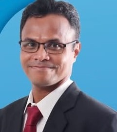
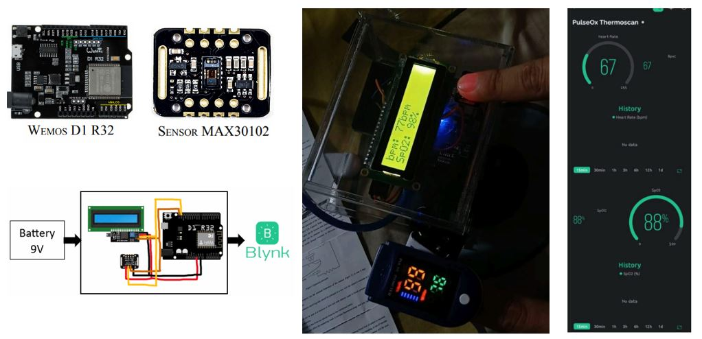
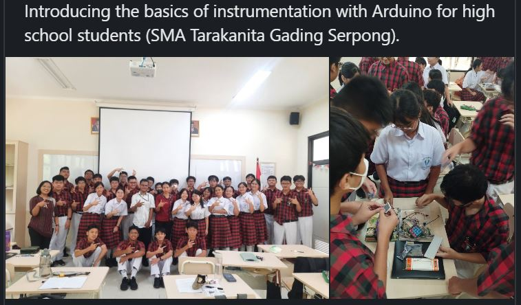

# Workshops & Webinars

Complete list of professional activities, presentations, and training programs.

---

## 2024

### Webinar: Deep Learning for Medical Image Analysis
**November 2024**

**Topic:** Advanced techniques in medical image analysis using deep learning

**Focus Areas:**
- Diagnostic applications
- Healthcare innovation
- Deep learning architectures for medical imaging
- Practical implementation strategies

[View Presentation (PDF)](../pdf/Webinar%20-%20Deep%20Learning%20MIA.pdf)

---

### Workshop: FSKoM Day 2024
**October 2024 | Matana University**

**Topic:** Oxygen saturation and heart rate monitoring using computer vision

**Covered:**
- Computer vision techniques for health monitoring
- Real-time sensor data processing
- Practical demonstrations
- Student engagement and Q&A

[View Materials (PDF)](../pdf/Workshop%20FSKOM%20Day%202024.pdf)

---

### Workshop: Arduino Programming
**September 2024 | High School Students**

**Topic:** Introduction to microcontroller programming and instrumentation

**Activities:**
- Arduino basics and setup
- Sensor integration
- Hands-on projects
- Building simple instruments

---

## Future Events

!!! info "Upcoming"
    Stay tuned for announcements about upcoming workshops, webinars, and training programs.

---

**[← Back to Activities](index.md)**
