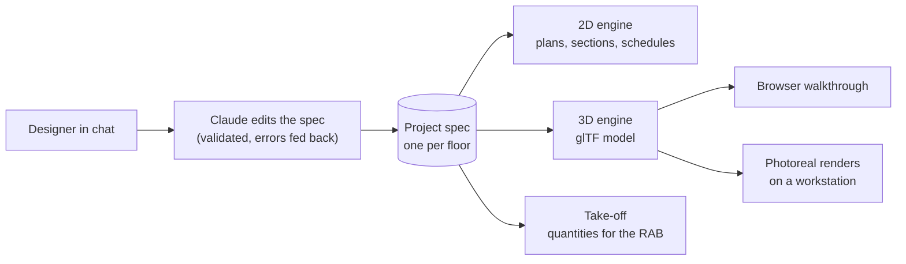

# AI Drawing Platform for Architecture and Interior Design

**Status:** Ongoing | In use by a company's internal design team since July 2026: chat-driven working drawings, quantities and 3D walkthroughs from one spec

## Executive Summary

An internal platform that produces **working drawings** (gambar kerja) for a design team that fits out food and beverage outlets. A designer describes what they want in chat; the platform returns exact, scaled sheets in the team's own title block as DXF, PDF and PNG, plus the quantities and a 3D walkthrough of the same space.

The rule that shapes everything: **the model reasons, engines draw.** Claude never draws a line. It reads the request and edits a structured JSON spec of the sheet. Deterministic engines then render every plan, section, schedule and 3D model from that spec, so scale and dimensions are always exact and every output agrees with every other.

---

## Key Results

| Metric | Value |
|--------|-------|
| Sheet types | floor plan, finish plan, ceiling and lighting plan, electrical and plumbing points, section and elevation, interior wall elevation, door and window schedule, quantity take-off, drawing list |
| Real drawing set reproduced | all 15 A3 pages of a real outlet's set, transcribed and checked |
| Chat edit round trip | about 9 seconds on the server, about 17 seconds locally |
| PDF import | a real drawing page to an editable spec in about 16 seconds |
| 3D | glTF model per floor, stacked building view, browser walkthrough on a phone |
| Parametric furniture | 19 symbol types in 2D, detailed parametric 3D versions, models under ~700 KB |
| Codebase | ~6,800 lines of Python and JavaScript, 31 API routes, 29 sample specs, single engineer |

---

## How It Works

- **The spec is the single source of truth.** Walls are centrelines with hosted doors and windows that break the wall where they sit, plus the grid, rooms with floor levels, furniture, finishes, ceiling heights, electrical and plumbing points and brand panels.
- **Every edit is validated.** If the model's edit breaks the schema, the errors go back to it once and it retries. Every edit becomes a version with an author and an audit trail, and can be restored. Issued revisions are written into the title block.
- **One AI worker, queued.** Chat and import run as background jobs with real progress stages (queued, editing, validating, retrying, rendering) shown live in the interface.

---

## Engineering Decisions

### Keep the model's output small

The first PDF import asked the vision call to read a drawing and also estimate coordinates for every room. That call hung for more than 300 seconds. Asking only for names returned in about 20 seconds. The import now has two steps: a bounded vision call (limited turns, read access to that one file) extracts a compact summary (title block, size, grid, room names and levels), and plain Python maps it to a spec and places the rooms on the grid for the designer to refine.

### A clash checker the model has to satisfy

An early chat edit put a bar counter on the wrong wall and added seven duplicate stools. Now every furniture footprint, built from the same shapes as the 3D model, is tested against walls, columns, doorways, door swings, other furniture and the building outline. Clashes are fed back to the model for up to three attempts, and anything left is returned as a visible warning, never silently. The instructions state the orientation, the rotation per wall and the walkway rules.

### Sections are cut, not drawn

Each floor sheet carries its level, and the floors stack into one building. A section or elevation stores only where to cut. The engine intersects the model with that plane for the cut faces, projects what lies beyond with a distance tint, and adds level datums, grids and dimensions. When a floor changes, every section re-cuts itself.

### Views that follow their floor

Finish, ceiling, electrical and plumbing sheets are views of a floor sheet, not copies, so they redraw whenever the floor changes. Electrical and plumbing points (16 types, each with a default mounting height) live on the floor sheet itself, and the quantity take-off counts the same points.

### Stable codes for doors and windows

Every door, window and open passage is grouped by type and given a code (P, J, B) kept in a per-project register, so a new size never renumbers codes already on issued drawings. Plans show the codes beside each opening and the quantities list openings by the same codes. Building this exposed a double count in the take-off, where a mezzanine sheet repeated its storey's openings; it was fixed at the source.

### Proved on a real drawing set

A real outlet's 15-page set was transcribed: its plan linework was an embedded picture, so positions were calibrated on the vector grid at 1:60 and read from the dimension chains to about 5 cm. The clash checker then found seven transcription errors. After fixing them, every page of the set was reproduced from specs.

---

## 3D and Renders

Every floor plan also becomes a 3D model: walls extruded with real openings, lintels and sills, glass, door leaves matching the plan swing, floors textured per finish, columns, ceilings and parametric furniture. The browser viewer (three.js, no build step) offers a dollhouse view, first-person walking with collision, room-by-room jumps, a mini-map, a measure tool and a full-screen link that works on a phone.

Photoreal renders come from Blender Cycles rendering the same model. Measured on a laptop, a 1080p frame at 128 samples took 628 seconds on the CPU and 91 seconds on the integrated GPU. Rendering is deliberately kept off the shared company server, which runs business-critical systems; the server only serves the walkthrough, which runs on the viewer's own device.

---

## Generative AI: Concepts Only

Image and video generators make convincing rooms but invent the geometry, so they cannot represent a design that someone will build. In this platform they are limited to optional, clearly labelled concept visuals made from the exact renders. Brand artwork is never generated: designers upload the real files, the spec references them by name, and a missing file shows as a grey board with a warning.

---

## Roadmap

The same rule extends to more disciplines, each owning a section of the spec:

1. **Architecture and interior set:** detail sheets at 1:5 and 1:10, unit prices on the quantities, width and egress checks, IFC export.
2. **Graphic design:** signage and menus as print-ready artwork at real size, placed in the model and on elevations at that size.
3. **Cinematography:** walkthrough films rendered from the exact model, with labelled concept clips on top.
4. **Structural pre-design:** structural plans and preliminary checks, marked preliminary until a licensed structural engineer signs them.

---

## Technology Stack

| Layer | Technology |
|-------|-----------|
| AI | Claude via headless CLI, vision import, schema-validated spec edits |
| 2D engine | Python, ezdxf, matplotlib (DXF, PDF, PNG) |
| 3D engine | trimesh, shapely, glTF export |
| Viewer | three.js (no build step), vanilla JavaScript |
| Backend | FastAPI, background job queue, versioned file store with audit log |
| Renders | Blender Cycles on a workstation |
| Infrastructure | Docker Compose |

---

*Built for a private client. The platform is internal, so it is described without screenshots, and the company name, brands, outlets and locations are omitted throughout. Architecture, engineering decisions and metrics are described as built.*
