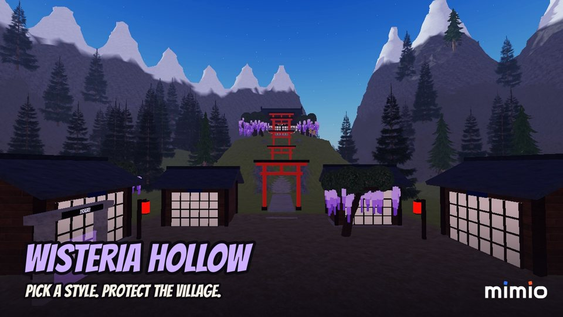
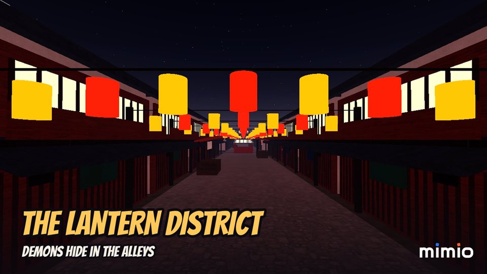
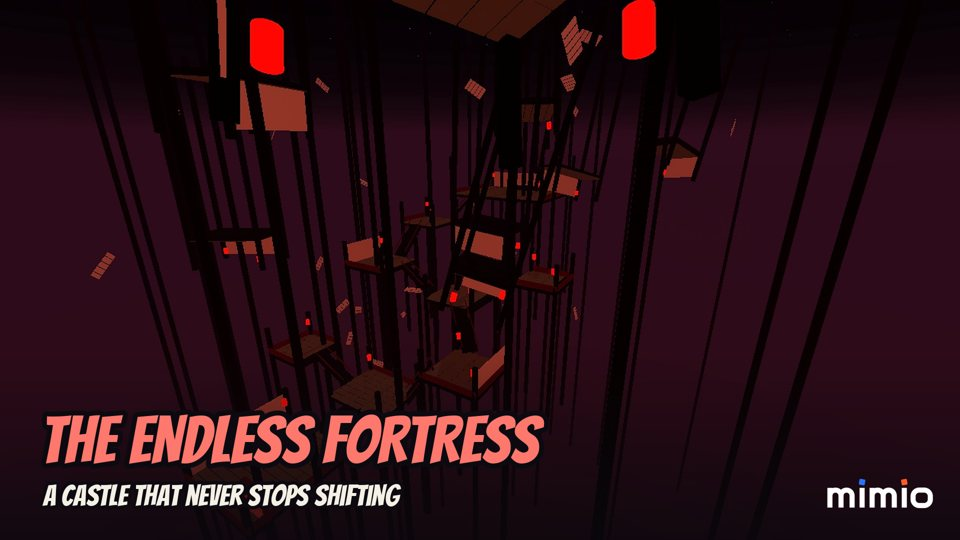
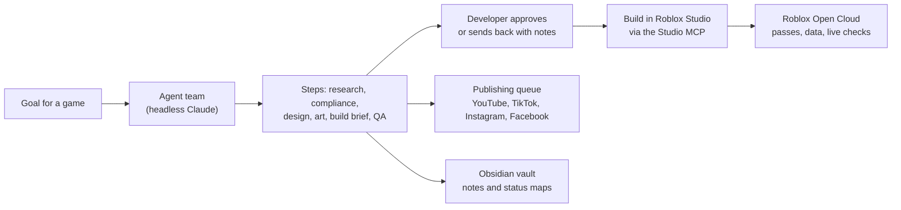

# AI Game Studio Automation for Mimio Entertainment

**Status:** Ongoing | First game, Wisteria Hollow, published on Roblox (private test, public release scheduled); first YouTube Short live

## Executive Summary

An AI automation system that runs a small game studio end to end: market research, compliance, game design, building the game in Roblox Studio, QA, store listing, marketing and publishing. A team of AI agents drafts every step, the developer approves what matters, and the same pipeline is built to take Unity or any other engine later.

Built for **Mimio Entertainment**, an independent Roblox game studio from Indonesia. The first game it produced is **Wisteria Hollow**, an original anime-style slayer adventure with six areas, seven fighting styles, saved progress, Bahasa Indonesia and English, touch controls and four game passes.

  
  
  

*Store thumbnails generated from real in-game captures taken by the pipeline in Roblox Studio.*

---

## Key Results

| Metric | Value |
|--------|-------|
| Agent team | 12 role agents (research, compliance, design, art direction, Roblox and Unity builders, QA, store, marketing, content, analytics, producer) on headless Claude Opus |
| Launch pipeline | 18 steps from research to post-launch review, with approval gates and human steps |
| Game built through the pipeline | saving with a session lock, levels 1 to 15 with area gates, two languages, mobile controls, a cosmetics shop and 4 game passes |
| Roblox integration | Open Cloud: experience status, game passes created with icons, data store checks and test scripts run on live Roblox servers |
| Marketing output | brand kit and store art generated from code; a 31-second Short recorded, edited, voiced and uploaded to YouTube from the dashboard |
| Engine scope | engine-agnostic: a new engine is one config entry plus one builder agent, no pipeline change |

---

## How It Works

- **Agents draft, the developer decides.** Each pipeline step is either an agent step (one call at a time, capped per day), a human step (building, playtesting, account setup) or an approval. Sending a step back reruns the agent with the developer's notes.
- **The game is built for real, not described.** The build runs in Roblox Studio through its MCP server: scripts are written, play sessions started, kills, travel and purchases tested on the server and the client, and the place published under the studio's Roblox community.
- **Nothing reaches the outside world without approval.** Roblox changes (new game passes, publishes) and social posts are requests on the dashboard that only run after the developer approves them; a post is never re-sent after an unclear result.
- **Everything is visible.** A web dashboard shows runs, approvals, posts and live Roblox status, and an Obsidian vault mirrors every step as notes and a canvas map coloured by status.

---

## The Game: Wisteria Hollow

- **Progression and saving:** a profile per player in Roblox data stores with retries, a session lock across servers, autosave and save on leave or shutdown; verified by playing, leaving and rejoining.
- **Two languages:** every text in the game, from dialogue to signs and prompts, in Bahasa Indonesia and English, following the player's Roblox language with an in-game switch.
- **Mobile first:** a large attack button and skill buttons laid out around Roblox's own jump button, checked in the device simulator.
- **Fair monetization:** coins buy looks only, and the four game passes give cosmetics or convenience, never power.
- **Original IP:** an AI review of the design flagged names that sat too close to an existing anime; the styles and the finisher were renamed and reworked before release.

---

## Technologies

Claude (headless CLI, Opus), Roblox Studio MCP, Luau, Roblox Open Cloud, Python, FastAPI, SQLite, Docker Compose, YouTube Data API, Obsidian, Playwright, ffmpeg, Pillow
