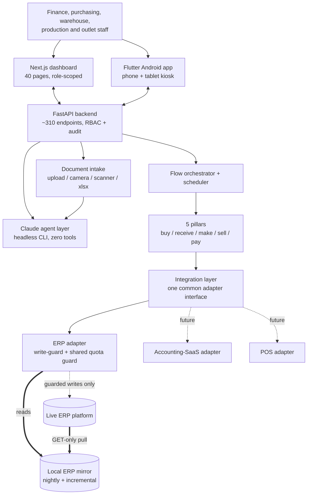
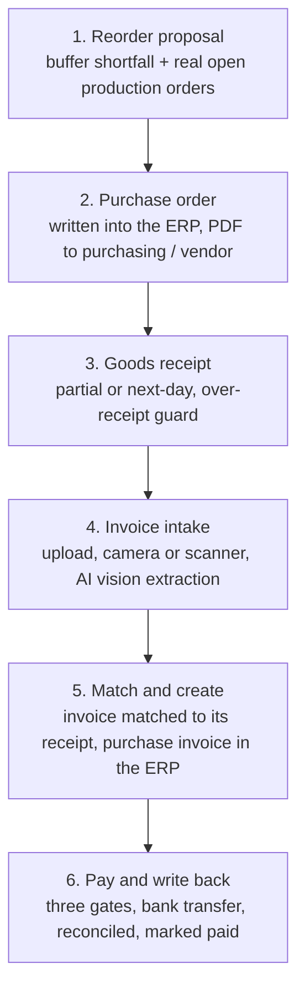
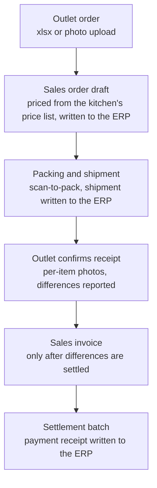
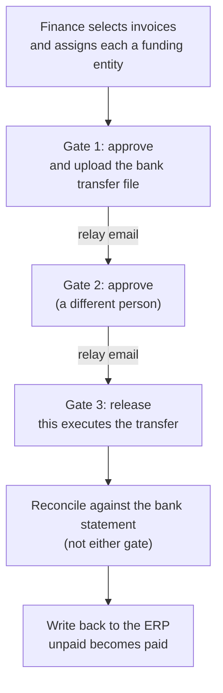

# Agentic ERP Automation Platform

**Status:** Ongoing | Live in production since July 2026: moving real money, writing 12 document types into a live ERP, used daily by finance, purchasing, warehouse, production and outlet staff

## Executive Summary

An agentic automation platform that sits on top of a commercial cloud **ERP platform** rented by a multi-entity food manufacturing and hospitality group, and takes over the back-office work that a team of people previously did by hand across spreadsheets, email, chat and manual ERP data entry.

The system automates one continuous supply chain, not a set of disconnected tools: **buy** raw materials from vendors, **receive** them into the warehouse, **make** finished goods in the central kitchen, **sell and ship** them to the group's own outlets and subsidiaries, and **pay** the vendor invoices, with funding tracked per subsidiary. Every pillar reads from a single mirrored copy of the ERP, and every write back into the ERP passes through the same guarded, idempotent, read-back-verified safety stack.

The hard engineering problem is not the AI. It is doing this **against a live production ERP with no sandbox, no test tenant, a hard daily API quota, and real company money on the other side of every POST**. That constraint shaped the entire architecture.

**What is live today:**

- **Purchasing:** purchase orders, goods receipts (including partial and next-day deliveries), AI-extracted vendor invoices matched to their receipts, purchase invoices created in the ERP.
- **Payment:** a three-gate approval flow that executes real bank transfers, bank statement reconciliation, and write-back that marks invoices paid in the ERP.
- **Production:** production orders and work orders generated from the real bill of materials, plus a shop-floor yield tracker.
- **Sales:** an inter-company flow from outlet order to sales order, shipment, invoice and settlement.
- **Warehouse:** stock opname and inter-warehouse transfers.
- **Delivery:** all of it through a web dashboard and a native Android app.

---

## Key Results

| Metric | Value |
|--------|-------|
| Operational pillars | 5 (purchasing and receiving, production, inter-company sales, warehouse, budget and payment) |
| Backend | ~57,000 lines of Python (FastAPI), plus ~13,000 lines of tests |
| Web frontend | ~39,000 lines of TypeScript (Next.js), 40 pages |
| Mobile app | ~6,600 lines of Dart (Flutter, Android), phone and shared-tablet kiosk mode |
| REST endpoints | ~310 |
| Database tables / migrations | 75 tables, 113 Alembic migrations |
| Automated tests | 620 test functions, run on every push in CI |
| Containerized services | 20 (app, ERP mirror, 9 scheduled sidecars, backups, monitors, ops tools) |
| Read-only AI data tools | 61 (MCP) |
| ERP write capabilities | 12 document types, each behind its own flag |
| Commits | 1,485 since 26 June 2026, single engineer |
| Production status | Live: real vendor payments, real POs, receipts, sales and production orders in the ERP |

---

## The Problem

The company runs a central production kitchen that supplies several subsidiary restaurant and cloud-kitchen entities. Its back office ran on a rented cloud ERP plus a sprawl of hand-maintained spreadsheets and chat threads. Every day, people were:

- Re-keying vendor invoices into the ERP by hand, field by field, line by line
- Deciding what to reorder by eyeballing stock against buffer levels kept in a spreadsheet
- Assembling payment batches in a workbook, emailing them around for approval, then re-typing them into the bank's corporate transfer portal
- Taking outlet orders by chat and spreadsheet, then re-entering them as sales orders, shipments and invoices
- Reconciling the bank statement against the payment list by hand

Two failure modes dominated: **transcription errors** (an invoice typed wrong is a wrong payment) and **no audit trail** (nobody could reconstruct who approved what, when, or whether a transfer actually cleared).

---

## System Architecture



### The three design principles that everything follows

1. **The ERP is the system of record. The platform orchestrates and writes back only where it is provably safe.** Reads come from the mirror wherever freshness allows. Writes are guarded, idempotent, pre-checked, and read-back verified.
2. **Human-in-the-loop wherever money moves or stock truth is uncertain.** The AI proposes. A person commits. There is no path in the codebase where a model's output causes a payment.
3. **Spreadsheets are a one-time source, never a runtime dependency.** The team's workbooks were read once, read-only, to extract both the data and the business logic. The logic was then reimplemented natively and the data re-homed into the platform's own database with in-app editors. At runtime the system talks only to the ERP and its own database.

---

## ERP Integration: the part that was genuinely hard

The ERP is a rented multi-tenant SaaS. There was no sandbox tenant, no staging instance, and no way to test a write without testing it on the company's real books. Everything below exists because of that.

### 1. A read/write split with a local mirror

Reading the live ERP on every dashboard render was never an option. So the platform runs a **GET-only mirror service**: scheduled sidecars that pull every resource the ERP tenant exposes (masters, purchasing, sales, manufacturing, finance, inventory, plus a ~200k-row journal) into a local store, then project it into Postgres. Heavy resources sync nightly and at fixed hours; fast-moving ones such as purchase orders use cheap incremental "tail" pulls every few minutes, so a new order is receivable almost immediately. The mirror is GET-only *by construction*: the only non-GET call it can make is the login itself.

```
Live ERP  --(GET-only, nightly + incremental)-->  Local mirror  -->  Postgres  -->  Dashboard / App
   ^                                                                                        |
   +--------------------- guarded, idempotent, single-document writes ----------------------+
```

Reads come from the mirror. Writes go directly to the live ERP through a separate, explicitly configured production target. Splitting the two means a misconfigured read path can never become a write, and a write outage never blacks out the dashboard.

A just-written document is copied into the mirror marked as platform-created, so the next screen sees it before the nightly sync. That copy is deliberately excluded from verification, so a document **can never confirm its own existence**. Verification re-asks the live ERP, and re-checks every "not found" over a fresh session before believing it.

### 2. A seven-layer write-guard

Any write into the live ERP has to survive all of these, in order:

| Layer | What it does |
|-------|--------------|
| 1. Host guard | The HTTP client refuses any POST/PUT/DELETE to a known production host unless a global master switch is explicitly on. GET is always allowed. |
| 2. Mirror-target refusal | A write that would land on the read mirror is refused outright. The mirror must never be mutated. |
| 3. Per-capability flag | Each of the 12 writable document types (payment, purchase order, goods receipt, purchase invoice, sales order, shipment, sales payment, stock transfer, stocktake, production order, work order, vendor/item master) has its **own** independent flag, so each capability can be canaried and enabled alone. |
| 4. Dry-run shadow mode | Builds the full payload and runs the pre-check read, but never POSTs. This was the substitute for the sandbox that did not exist. |
| 5. Idempotency claim | Every document carries a deterministic client-generated code. The ERP rejects a repeat of the same code, so a retried request physically cannot double-pay or double-order. A duplicate error is treated as success. |
| 6. Pre-check and sanity caps | Read-before-write against the **live** ERP (not the mirror) to confirm the target is still in the expected state, plus per-transaction value ceilings. |
| 7. Read-back verification | After the write, read the document back from the ERP and confirm it landed as intended. Per-row commit, so a partial batch failure never leaves an inconsistent local state. |

Every write capability was rolled out the same way: dry-run, then a canary against a single real document (marked as a test and deleted afterwards where the ERP allows it), verified in the ERP's own UI by a human, then enabled.

**A timeout is an unknown, not a failure.** If a write times out, the ERP may or may not have created the document. The platform never records that as failed and never offers a blind resend. It keeps the idempotency claim, shows the state as *uncertain*, and offers a read-only re-check against the ERP instead. A reconciler later finds documents the ERP created but the platform never heard back about. Recording a timeout as a failure is exactly how a system ends up shipping the same goods twice.

### 3. Living inside a hard daily API quota

In late September the ERP started returning HTTP 429 on every route for the rest of the day. Measuring it showed a **fixed per-tenant daily quota of a few thousand calls, reset at midnight, not a rolling window**, and that background syncs alone were consuming most of it. When it trips, the whole company is locked out of its own ERP until midnight, including the people working in the ERP's own UI.

The fix was a **shared quota guard** used by every process that talks to the ERP: the backend, nine sidecars and the mirror.

- **Shared state.** All processes use one file-locked state file, so a 429 seen by any process brakes all of them at once. Recovery uses a doubling back-off and a single probe call instead of a retry storm.
- **Priority budgets.** Daily budgets per channel come in three priorities: background reads stop first, user reads next, and writes keep the last slice of the day.
- **Fewer calls.** The shipping write path dropped from three API calls to one. Hourly full pulls were replaced by incremental tails, and single documents are fetched on demand.
- **Forecasting.** Every call is attributed to its sender. A daily forecast sits on the monitoring dashboard with email alerts before the limit, not after.

A second, subtler limit surfaced next. The ERP allows **one browser session per user**, and some operations (such as setting work-order fields the API silently ignores) must go through its web forms. Each process signing in on its own evicted the others, and an evicted session answers with an empty `200 OK` that looks exactly like "document not found". The fix is one shared stored session and a single signer. A design that trusted that empty 200 would have concluded that real documents did not exist.

### 4. Discovering what the API actually does, not what the docs say

The vendor documentation was incomplete and in places wrong. Findings that changed the design:

- **The API and the ERP's own stock report disagree** on roughly 23% of item/warehouse pairs. Since the team trusts what they see in the ERP UI, on-hand stock is read from the report path, not the API, so the platform matches what a human sees.
- **The reorder buffer field is report-only.** It cannot be read live or written back through the API, so buffers were re-homed into the platform's own tables, derived from actual consumption history with manual per-item overrides.
- **Receipt lines for rounding, fees and down payments are refused** by the ERP. The platform zeroes and locks them, drops them from outstanding quantities, and surfaces the ERP's own error body. Hundreds of purchase orders had been stuck as "open" because of this.
- **Some fields are accepted by the API and silently ignored**, so they are set through the ERP's own web-form model instead, one run at a time, with a single safe retry.
- **Purchase invoices cannot be deleted through the API** (create and read only), which made the canary-and-verify discipline for that document type non-negotiable.
- **Two different authentication dialects** between the mirror source and the write target, handled by an auth-mode switch in the client.

### 5. Statistical grounding before writing any code

Before building the invoice-to-ERP path, the mirrored history was analysed to find out how documents actually flow in practice:

- 90.6% of purchase invoices are created **from a goods receipt**, not from a purchase order and not standalone
- Order to receipt is one-to-one 97.4% of the time
- The invoice total matches the order total only 48% of the time, and vendor plus total uniquely identifies an order only 23% of the time

That last pair ruled out the obvious design. Amount matching is not a reliable key, so matching is **proposed** by the system with ranked candidates and confidence reasons, and **confirmed** by a human. And because the goods receipt is authoritative for item codes and quantities while the invoice is authoritative for prices, the created invoice is built from the receipt lines and enriched with invoice prices. That single decision removed the entire item-code mapping risk and made stock double-counting structurally impossible.

---

## Pillar 1: Purchasing and Receiving



**Reorder proposal.** Each item gets one number: `max(0, buffer + committed_demand - on_hand)`, where committed demand comes only from **real open production orders in the ERP**. An earlier version also added the platform's own projected production demand. A root-cause review showed that projection could drive purchases nobody needed, so it was removed from the buy math and kept as advisory only. Vendor suggestions use the cheapest price within the last 12 months, never the cheapest price ever. Purchasers can split one need across several vendors, pick the destination warehouse per order, and create a missing item or vendor inline (both written to the ERP master behind their own flags).

**Purchase orders** are written to the live ERP with the raising employee mapped onto the document-owner field, and the ERP's own PDF is shown in-app and sent to the vendor. An admin can cancel a platform-created order, which required discovering that a completed order must be reverted before it can be deleted. An order that will never be fulfilled can be closed platform-side, reversibly, without touching the ERP.

**Goods receipts** are written to the ERP as completed documents with the real arrival time. Partial and next-day deliveries are supported, and receiving more than ordered is only allowed when backed by a photo of the supplier's delivery note. The hard part was **mirror lag cutting both ways**: a revised receipt must disappear from open-order lines immediately, and a fresh platform receipt must count before the mirror sees it, or the same goods could be received twice. Both are handled by a platform-side receipt index that is merged with the mirror on every read.

**Invoice intake and AI vision extraction.** Files, phone photos, or a one-click network scan (eSCL/AirScan) feed one pipeline. Several files or frames become the pages of one document. Claude vision extracts exactly the fields a human would type into the ERP's purchase invoice form: vendor, numbers, dates, terms, line items, taxes, charges, totals, bank details. The schema was learned read-only from the ERP's API reference. Extraction runs in a background worker, and stranded jobs are requeued on restart. A **duplicate-invoice detector** blocks a second copy of the same bill before any money can leave. Prices are judged against the purchase order, and an OCR-tolerant parser handles the many ways a PO number gets printed or misread.

**Matching and purchase invoice creation.** The matcher resolves the vendor, finds candidate receipts, and returns them ranked with the reasons behind each confidence. The draft merges receipt lines with invoice prices and flags every quantity and price variance. Only a human-confirmed draft becomes a purchase invoice in the ERP.

**Management views:** purchasing performance, a daily control page for management, open-order and "out of stock but not ordered" backlogs with a daily digest email, and purchase tracking with spreadsheet export.

---

## Pillar 2: Production

- **Production orders** are created in the real ERP, served as the ERP's own PDF plus a generated recipe page, and sent to the kitchen via a WhatsApp link, with result photos and documents attached afterwards. A live existence check self-heals orders that someone deleted directly in the ERP.
- **Work orders** are generated as drafts from the real bill of materials. Supervisor and business unit are fields the API ignores, so they go through the ERP's web form model. This was verified with a marked test canary before going live.
- **Yield tracking:** a shop-floor form records start and finish, actual quantity, the person in charge, obstacles and a photo per order. A pivot-style report compares planned against actual. The team's historical workbook was imported once; lists such as staff and obstacle categories are maintained by the team, never guessed.
- **A kitchen TV monitor** refreshes every 30 seconds from local tables only, costing zero ERP quota.

---

## Pillar 3: Inter-Company Sales

This was "planned" in the August version of this page. It is now live end to end, mirroring the purchasing machinery on the sell side.



- **Order intake from spreadsheets at scale.** Outlets keep ordering the way they always have. A multi-outlet workbook becomes one draft per sheet, item names are resolved against the item master through a learned alias table (an exact match on the same document always beats an alias), and every unresolved line is surfaced rather than guessed.
- **Shipment and invoice are separate steps owned by different teams.** The warehouse ships; accounting invoices only after the outlet confirms receipt and any difference is settled. Testing showed a posted shipment can be reverted and corrected in place without renumbering, which made the correction flow possible.
- **Never-booked detection.** The kitchen's sales invoices are reconciled against the subsidiaries' own payables, so invoices a subsidiary never recorded are found automatically instead of at year end.
- **Finance views built on the same mirror:** a balance sheet from the mirrored chart of accounts and journal (reconciled nightly against the ERP's own report), receivables per customer per week, AP/AR per invoice, and a cost-of-goods control that compares the price list against actual billing using the ERP's own bill of materials, with the arithmetic shown.
- **Performance:** the sales invoice page went from 23 seconds to 84 milliseconds, and it previews every document before anything is created.

---

## Pillar 4: Warehouse and the Mobile App

A native **Flutter Android app** shipped from first commit to version 0.8 in three days, backed by a dedicated mobile API on the same backend.

- **Two modes.** A personal phone app, and a **shared-tablet kiosk** with station enrolment, per-user PIN, Android Lock Task and idle lock.
- **Features:** goods receiving, outlet receipts with per-item photos, scan-to-pack shipping, printable QR item labels, stock lookup, the production report, the AI assistant, push notifications, and a forced-update floor for releases nobody may skip.
- **Stock opname** writes a draft stocktake to the ERP with counted quantities only, so the ERP computes the adjustment itself. **Inter-warehouse transfers** are written as completed transfers. Both use client codes the ERP refuses to duplicate, both are read back, and a timeout shows as *uncertain* with a re-check, never a resend.
- **Locale bugs are money bugs.** An early build parsed the Indonesian thousands format "15.000" as 15, which would have under-recorded receipts by a factor of a thousand. It was fixed in a forced-update release and pinned with regression tests.

---

## Pillar 5: Three-Gate Payment with Enforced Separation of Duties

This is where real money moves, so the flow is deliberately slow and deliberately human.



- **Three distinct gates, three distinct people.** Separation of duties is enforced in code, not policy.
- **Sequential relay email** with magic-link approval, not a broadcast.
- **Funding tracked per subsidiary** in weekly budget rounds, shown live against the current selection, with one transfer file per funding entity.
- **`released` stays distinct from `paid`.** The platform waits for the bank's own record.
- **Reconciliation** auto-matches statement lines (CSV or xlsx) using the invoice code in the transfer narrative, takes the payment date from the bank movement, and queues the rest for a human. It also surfaces the **inverse exception**: invoices marked paid that no bank line has confirmed.
- **A money-critical fix, found and closed.** The write-back pre-check originally read the mirror. A mirror that lagged behind a payment made directly in the ERP could have let the platform post the same payment again. The pre-check now reads the live ERP. Over 700 invoices were then settled through write-back with zero anomalies. Payments whose read-back failed get a read-only "re-check in the ERP" action instead of a retry.

---

## The AI Layer

Three distinct uses of AI, each scoped tightly to what it is allowed to touch.

### 1. A decision agent with zero tools

The agent runs through a headless CLI, and **every tool is disallowed**. The agent cannot read files, run commands, reach the network, or touch the ERP. It receives context assembled by Python and returns structured reasoning. Python stays in control of every side effect: *the model proposes, the execution layer disposes*, and the execution layer is where the approval queue, idempotency, append-only audit log, and read-back verification live. For document extraction the agent is granted exactly one capability, reading the single uploaded file, scoped to that file's directory.

### 2. A read-only conversational data layer

**61 MCP tools**, every one of them read-only, spanning payables, purchasing, receiving, stock, production, sales reconciliation, the balance sheet and data provenance. The allowed-tool list is generated from a decorator registry, so a new tool cannot be exposed without being registered as read-only.

The chat panel is on every page and in the mobile app, carries the active page context, and can open a page with filters already applied through an allowlisted navigation intent (view control only, never actions). It can query everything and change nothing, a provenance tool answers "where did this number come from", and guards stop it from turning a projection into buying advice or guessing at figures it cannot ground.

### 3. Vision extraction

Covered above. The extraction schema was reverse-engineered from the ERP's API reference, read-only, rather than by probing live company data.

---

## Reliability, Security, and Operations

- **Append-only audit log** across all pillars: every approval, release, match, receipt and ERP write records who, when, and what.
- **Role-based access control** with a department plus tier model, per-account menu access, login history, and default-deny accounts for outlet users.
- **620 automated tests** run in GitHub Actions on every push, together with a migration smoke test.
- **An isolated staging environment** mirroring production, with a safe-promote routine: preview the diff, back up the database, rebuild only changed services, verify row counts.
- **Monitoring:** a Prometheus and Grafana stack covering service health, the ERP quota forecast, and data freshness. An independent integrity monitor compares platform state against the ERP and checks that documents the platform wrote still exist.
- **Backups, local and offsite.** A failed database dump had once been stored and announced as "backup ok"; the job now validates the dump before it reports success.
- **In-app issue reporting:** staff report problems in a chat-style ticket thread with attachments. Requests outside the platform's current scope are held for an emailed approve or reject, so a ticket can never act as an unreviewed work order.
- **A "live floor" view:** the whole operation rendered as an animated pixel-art office driven by the audit log, with a 60-day replay. It runs on a read-only database role, so it cannot change anything.
- **Small things that matter to users:** unsent form edits are auto-saved with restore and discard, Indonesian number entry, laptop-zoom-safe layouts, and Google sign-in that works inside WhatsApp and Gmail in-app browsers.
- **Secrets never in the repository**, enforced by a git hook.
- **20 containerized services** on Docker Compose on a single VPS, a deliberate choice over Kubernetes for a team of one, recorded as an architecture decision record.

---

## What Made This Genuinely Difficult

**No sandbox.** The response was a local stand-in that speaks the same API surface, read-only mirroring of real data, dry-run by default, and canarying one document at a time.

**A hard daily quota shared with the humans.** Every background call competes with the finance team working in the ERP's own UI. Exceeding the quota locks everyone out until midnight, so API calls had to be budgeted, prioritised and forecast like money.

**Unknown outcomes.** Timeouts, evicted sessions that return an empty success, and a mirror that lags in both directions all look like "it didn't happen" when it might have. The platform is built to say *uncertain* and check, never to guess and retry.

**The ERP disagrees with itself.** The API and its own reports return different stock figures. Resolving that meant tracing which surface the humans actually trust and matching it.

**The users are not engineers.** The dashboard and app are fully in the users' native language and built around how each team already works: outlets still send spreadsheets, the kitchen gets a printable recipe page with every production order, the warehouse scans instead of types.

**Money is unforgiving.** Nothing in the payment path is autonomous, every gate is a different human, and the platform refuses to call something paid until the bank says so.

---

## Technology Stack

| Layer | Technology |
|-------|-----------|
| Backend | Python, FastAPI, SQLAlchemy, Alembic, Pydantic, pytest |
| Web frontend | Next.js, React, TypeScript |
| Mobile | Flutter (Android), kiosk mode, push notifications, QR labels |
| Database | PostgreSQL (production), SQLite (local dev and mirror store) |
| AI | Claude via headless CLI, vision extraction, MCP tool server (61 read-only tools) |
| Integration | REST adapters behind a common interface, guarded write client, shared quota guard, GET-only mirror service, xlsx/CSV ingestion |
| Documents | PDF and image generation, eSCL/AirScan network scanning, spreadsheet import and export |
| Infrastructure | Docker Compose (20 services), Nginx, Ubuntu VPS, isolated staging, Prometheus and Grafana, automated local and offsite backups |
| Delivery | GitHub Actions CI, git hooks, Alembic migrations, per-service rebuild promotion |

---

## Current Status and Roadmap

**Live in production:**

- **Purchasing and receiving:** reorder proposals, purchase orders, partial and next-day goods receipts, order cancellation and closing, vendor and item master creation
- **Invoice pipeline:** multi-channel intake, AI vision extraction, duplicate detection, receipt matching, purchase invoice creation
- **Payment:** three-gate approval, real bank transfers, statement reconciliation, ERP payment write-back
- **Production:** production orders, work orders from the bill of materials, yield tracking, kitchen monitor
- **Inter-company sales:** outlet order to settlement, plus balance sheet, receivables and cost-of-goods control
- **Warehouse:** stock opname and inter-warehouse transfer
- **Android app:** phone and kiosk modes
- **Platform-wide:** shared ERP quota guard, monitoring, the read-only AI assistant

**In progress:**

- Further cuts to ERP quota usage: an incremental journal pull and on-demand fetch for receipts and invoices
- A management "control tower" dashboard
- An in-app editor for reorder buffers
- A production preparation module

**Planned:**

- Outlet-level stock, once outlet usage data can be sourced from the group's point-of-sale systems
- Expiry-aware (FEFO) picking, expiry reminders and returns in the mobile app
- Direct WhatsApp vendor delivery beyond the current deep-link flow
- Adapters for the group's accounting and point-of-sale systems, which is an adapter implementation rather than a platform change

---

*Built for a private client. Company name, ERP vendor, and internal identifiers are omitted deliberately. Architecture, engineering decisions, and metrics are described as built.*
