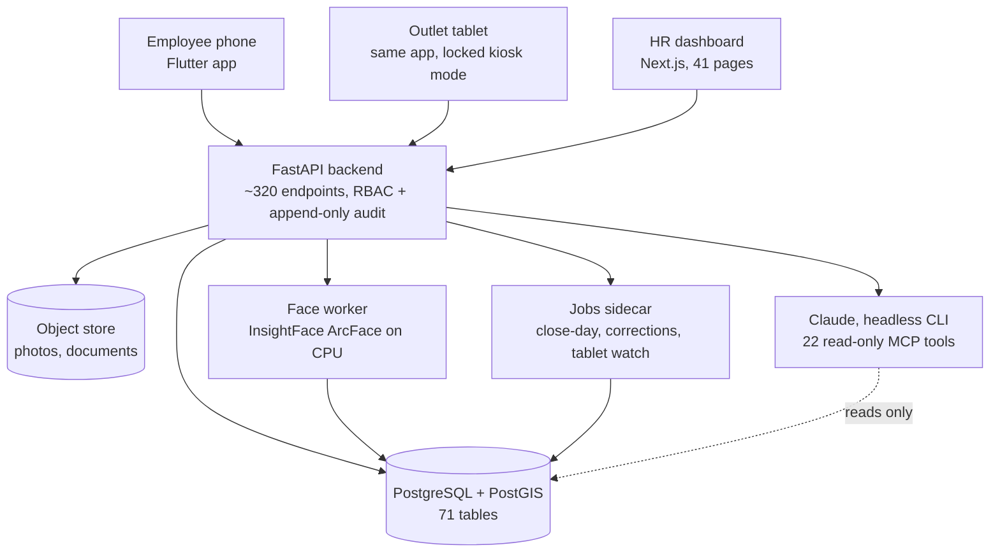

# HR & Face-Attendance Platform (Mobile, Kiosk, Web)

**Status:** Ongoing | In production as the company's attendance system since October 2026, used every day on shared outlet tablets

## Executive Summary

A company-owned HR platform for a multi-site food and beverage business. It replaces a fingerprint machine plus a stack of spreadsheets with three surfaces on one backend:

- an **Android app for employees**, covering face attendance inside a geofence, schedule, leave, overtime, corrections, personal data requests, announcements, warning letters and payslips;
- the **same app in kiosk mode on a store tablet**, a shared clock-in station where staff clock by face with no login at all, locked down so it behaves like an appliance;
- a **web dashboard for HR**, covering the employee master, attendance and corrections, contracts and renewal recommendations, incidents, salary progression, recruitment with psychological tests, reimbursement and cash advances, the org structure, payroll, and a read-only AI assistant.

The interesting engineering is not the CRUD. It is that **biometric attendance is money data and sensitive personal data at the same time**: every clock-in feeds payroll, and every face template falls under Indonesia's personal data law (UU PDP No. 27/2022). Since going live, a third constraint has joined them: **it has to work on a busy kitchen floor at shift change**, where a clock that takes a minute is a clock nobody uses.

!!! note "Where it came from"
    An earlier prototype, the [Agentic HR Intelligence Platform](agentic-hr-platform.md), established the feature set from imported PDF and spreadsheet exports. This platform re-implements all of it on a native data model, where attendance is captured at the source instead of imported, and adds kiosk tablets, recruitment, payroll and the compliance work below.

---

## Key Results

| Metric | Value |
|--------|-------|
| In production | Attendance system of record since October 2026, used daily on shared tablets |
| Workforce on the platform | the whole workforce, across many work sites and several legal entities |
| Face match quality after adaptive templates | Median similarity 0.77 to ~0.85, first-try success 72% to 90%, zero wrong-person matches |
| Backend | ~19,900 lines of Python (FastAPI), 26 routers |
| Web dashboard | ~12,500 lines of TypeScript (Next.js), 41 pages |
| Mobile app | ~7,600 lines of Dart (Flutter, Android), over 35 releases shipped over the air |
| REST endpoints | ~320 |
| Database | 71 tables, PostgreSQL + PostGIS, 49 Alembic migrations |
| Automated tests | 225 backend test functions on PostGIS in CI, plus web lint and build |
| Read-only AI tools | 22 (MCP), permission-scoped per user |
| Delivery | 255 commits from the first commit on 8 September 2026, single engineer |

---

## The Problem

Attendance ran on shared fingerprint machines and monthly exports. Everything downstream of it was manual:

- The monthly recap arrived as spreadsheets that HR re-keyed before payroll.
- Contract renewals were tracked by hand, so a timely decision depended on someone remembering.
- Hiring, incidents, warnings, salary raises and cash advances lived in separate files and chat threads, so nobody could see one employee's story in one place.
- There was no audit trail. Who edited a clock-in, and why, was not a question the old setup could answer.

A fingerprint machine also fails exactly where this company operates: wet hands in a kitchen, high turnover, and staff who move between outlets.

---

## Three Surfaces, One Backend

Two design rules run through all of it:

1. **The numbers never depend on the model.** Every figure on every page is computed in SQL. The AI writes narratives and answers questions; it never produces a number that a human then acts on without the query behind it.
2. **Biometrics never leave the server.** The phone detects a face; it never computes an embedding. Templates are encrypted at rest and have no export endpoint at all.

---

## The HR Dashboard

*The platform is internal to the company, so this page describes it in words and diagrams rather than screenshots.*

The home page answers "what needs me today": who is present right now, the queue of things awaiting a decision (contracts, corrections, salary proposals, stalled candidates), a 14-day attendance chart, and the recruitment pipeline with the week's interview agenda.

Attendance today lists the full scheduled roster, not only the people who clocked, so an absence is visible as an absence rather than as a missing row. Anything HR changes here goes through a correction with a reason and lands in the audit log.

The employee master covers the whole workforce with server-side sorting on every column, filters by entity, brand, site and contract expiry, bulk activation codes, and Excel import.

---

## Attendance: Face Verification Inside a Geofence

A clock-in has to satisfy four independent checks before it becomes a record.

**1. Liveness and capture, on the device.** The app captures a three-frame burst with ML Kit face detection rather than a single still, coaches the person on distance and angle, and the server checks replay hashes and a texture score. Two liveness modes exist: a head-turn challenge, and a straight-on mode about three times faster for the shift-change rush. Which one runs is a server setting, so the balance between speed and strength can change without an app release.

**2. Face verification, on the server.** InsightFace ArcFace (buffalo_l) runs through onnxruntime on CPU inside the worker container, because the company has no GPU and verification costs tens of milliseconds. Cosine similarity against the employee's templates accepts above a threshold, rejects below a lower one, and **flags the band in between for HR review** instead of guessing. Keeping the embedding server-side means thresholds, coaching limits and liveness mode can be retuned without shipping an app release.

**3. Geofence.** Each work site has a point and a radius in PostGIS, and the clock carries its distance. Sites are placed by pasting a Google Maps link, searching the name, or clicking the map, and a site supervisor can set it from the phone while standing in the outlet.

**4. Device and permission.** Accounts are bound to a device; mock location, rooted devices and clock skew are checked. Clocking from a personal phone is **off by default and granted per employee by HR**, and the server enforces it, including for queued offline clocks and older app builds that do not know the rule exists.

### The attendance rules engine

Real shifts broke the simple model within days, so the rules became an engine of their own:

- **One clock-in and one clock-out per day.** A duplicate is answered as information, not as an error. A clock-out without that day's clock-in is refused; the trial data had 40 such days.
- **Night shifts across midnight.** Clock-out, break and overtime attach to the shift that started within the previous 18 hours, so a clock-out at 01:00 no longer lands on the next calendar day.
- **Break and overtime clocks.** Break in and out happen inside the shift. Overtime in and out file a request that HR approves afterwards, and the employee is notified of the decision.
- **Lateness done right.** A bug applied the grace period twice. Now the per-site tolerance only decides *whether* someone is late, and minutes are counted from shift start.
- **People who move.** Clock in at one branch and out at another, one tablet serving several sites, and a per-employee "clock at any site" switch for area managers. Cross-site clocks are flagged, not blocked.
- **Self-healing days.** A scheduled job turns every half-recorded day into a pending correction in HR's queue. Jobs run on the clock minute rather than on an interval, so a restart can never skip the noon run.

---

## The Store Tablet: Kiosk Mode

Not every employee has a phone they want to use for work, and crew turnover is high. The same Flutter binary therefore also runs as a **shared outlet clock**: one tablet, pinned to one or more work sites, no login and no session.

HR creates a tablet in the dashboard and gets a six-character pairing code. The tablet takes the code once and stores a long-lived kiosk token. Codes are single-use and expire, and revoking a tablet kills its token immediately.

- **The roster is the scope.** A kiosk compares a face only against employees placed or scheduled at its sites that day, never company-wide. That is a privacy control and an accuracy control at once.
- **Ambiguity falls back to a name.** The best match must beat the runner-up by a margin. Every frame of the burst must pick the same person. If either check fails, the tablet asks for the employee's NIK and re-checks one to one.
- **An appliance, not an app.** A built-in kiosk lock replaced a paid third-party kiosk app. The app becomes the home screen and pins itself, and only a PIN gets out. As device owner it updates silently. It reopens itself after an update and after a power cut, which needed an invisible overlay on Android 15. HR controls the lock per tablet, and the tablet reports back what it actually did.
- **Watched from the server.** A jobs sidecar emails HR when a tablet goes silent for more than a few minutes and again when it is back. Every tablet reports its app version on each poll.
- **Every attempt is measured.** Each kiosk attempt is logged with outcome, reason, scores, head angles, frame similarity and timings, but no photo, and kept for 180 days. Every tuning decision below came from that table.

The dashboard shows tablet readiness per site, so a rollout is a list of rows with a "create tablet" button rather than a project plan.

---

## Going Live: What the Floor Taught Us

The first weeks in production were spent turning measurements into fixes:

- **A one-minute clock became a few seconds.** Server inference for the whole burst took about 0.9 seconds, so the delay was on the tablet. Three causes:
    - a frontal-pose gate that a tablet's viewing angle could never satisfy;
    - head-turn measured against an absolute pose instead of the person's own neutral pose;
    - a hard-coded frame rotation that was wrong on tablets.
- **Liveness, honestly.** Before relying on a passive anti-spoof model, the free models were evaluated on attack samples. Too many spoofed frames got through, so they were rejected rather than shipped as security theatre. Liveness rests instead on the server-issued challenge, roster scoping, the same person in every frame, and HR review of borderline matches.
- **Adaptive templates.** When a tablet clock identifies someone clearly (a wide margin over everyone else on the roster), the face is kept as one of up to five encrypted learned templates for that employee. Templates are never learned from a NIK fallback, and HR can reset them per person. Measured effect:
    - median match from 0.77 to about 0.85;
    - first-try success from 72% to 90%;
    - no wrong-person matches.

---

## The Employee App

The phone app is the employee's own copy of their record: today's shift and clock state, attendance history with a date picker, schedule, leave and overtime requests, corrections started from the day in question, notifications, announcements, signed warning letters, payslips, and requests to change personal data that go to an HR queue. Face enrollment has an explicit consent step.

Enrollment does not trust itself: an employee submits photos, the server builds the template, and **HR approves it** before it can verify anything. Raw enrollment photos are deleted once the template is approved. Releases ship outside the Play Store from a published manifest, with a non-dismissible floor for builds nobody may skip. More than thirty-five releases went out this way in the first month.

---

## People Records: Contracts, Incidents, Salary

With hundreds of employees on rolling fixed-term contracts, the expensive mistake is a contract that quietly lapses.

A rule engine scans contracts 90, 60 and 30 days out and produces a recommendation (extend, make permanent, do not extend, review) from attendance rate, lateness, alpha days, active warnings, incidents, tenure and the statutory five-year PKWT cap. **The rules decide; the model only writes the sentence.** Thirty days before the end, the direct manager gets an in-app and email link to an assessment form, with a reminder a week later. HR sees the recommendation next to the raw numbers and the manager's assessment, makes the call, and the next contract is created in the same step.

Alongside it sits a turnover risk score, 0 to 100, built from contract stage, lateness and alpha over 90 days, active warnings, serious incidents, and time since the last raise. Every row shows the factors that produced the score, so it reads as evidence rather than as an oracle.

Incidents carry SP1 to SP3 warning validity windows and a manager sign-off. Salary raises run through two gates, with the proposer never approving their own proposal and board approval required above a threshold. Everything an employee has been through is rendered as one timeline on their record.

---

## Recruitment and Psychological Testing

Added in October, so hiring feeds the same employee record instead of a separate spreadsheet:

- **Requests to vacancies.** A manager requests staff, approval opens a vacancy, and candidates move across a board with CVs, interviews and notes. Hiring a candidate creates the employee and their first placement in one step, followed by an onboarding checklist.
- **A public careers page** and **AI-assisted CV reading**, which scores each CV against the vacancy's criteria one by one, including an expected-salary check. The model reads the CV; a person decides.
- **Interview scheduling** with calendar invites, message templates, daily workers, and a recruitment report with time-to-hire and cost.
- **Four psychological instruments, built in:** a 16-type personality inventory, DISC, a 60-item timed ability test, and the Kraepelin arithmetic test. Each candidate gets one link with no login. **The server keeps the clock and does the scoring**, so a candidate cannot pause a timed test or see an answer key in the page source.

---

## Reimbursement, Cash Advances and the Org Structure

- **Reimbursement and cash advance (kasbon)** requests go HR first, then the board, then payout. Advance instalments are recorded by hand or deducted by payroll, never both in the same month.
- **Org structure:** job levels, brand per location, a direct manager per placement, and an org chart. The direct manager is what routes contract assessments and team requests to the right person.

---

## Payroll

The payroll engine computes per entity, per month, on a 26th-to-25th cut-off matching the attendance recap:

- effective salary, with pro-rata for joiners and leavers;
- alpha deductions, and overtime under PP 35/2021;
- incident deductions and cash-advance instalments;
- BPJS Kesehatan and Ketenagakerjaan, with their caps;
- PPh 21 by the TER method, with a December annual reconciliation.

It produces payslip PDFs, a multi-bank transfer spreadsheet and a journal CSV, behind a compute, approve and pay workflow with separation of duties.

It is deliberately **not live yet**. Salaries are still paid through the company's existing system while the TER tables are verified against PMK 168/2023 and a one-month parallel run is prepared. Payroll that is merely probably right is worse than payroll that is honest about being unverified.

---

## The AI Layer

Three uses, all narrow.

**A read-only assistant** over **22 MCP tools**: employees, attendance, contracts, incidents, salary status, payroll, turnover risk, leave, overtime, the org structure, face enrollment status, site readiness, claims, vacancies, candidates and onboarding. A platform-guide tool answers "how do I…" questions from the user manual. Every tool is read-only and scoped to the asking user's permissions and entity, so salary and payroll tools simply refuse for a user without that right. Each answer shows the tool calls that produced it, and every exchange is logged.

It runs Claude through its headless CLI with every built-in agent tool disallowed, so the read-only tools above are the only things it can reach. Tools are loaded up front, up to three answers run at once, the page shows progress while it works, and conversations persist across pages.

**CV reading** in recruitment, scored criterion by criterion against the vacancy, with a human making the decision.

**Narratives** for contract recommendations and briefings, written from figures the backend already computed. When the model is unavailable the platform degrades rather than invents: narratives are left empty instead of faked, and every number stays correct because none of them came from the model in the first place.

---

## Privacy and Compliance

Biometric templates and precise location are specific personal data under UU PDP No. 27/2022, so the platform carries a working data protection note as part of the repository, not as an afterthought.

| Control | Implementation |
|---------|----------------|
| Consent | Collected in the app at first login, versioned Indonesian text, stored with a timestamp; withdrawal switches the employee to supervisor-witnessed clock-in |
| Template storage | 512-dimension vectors, encrypted at rest with an application key, **no export endpoint**, readable only by the backend worker; learned templates capped at five per person and resettable by HR |
| Retention | Enrollment photos deleted 30 days after approval; clock-in photos kept 90 days, then only the score; kiosk attempt telemetry keeps no photo; templates deleted 30 days after the recorded exit date |
| Minimisation | A kiosk matches against its own sites' roster for one day, never the whole company |
| Access | RBAC by role, entity and site, with per-employee phone-clocking permission |
| Accountability | Append-only audit log of every correction, approval, decision and device action |

---

## Reliability and Operations

- **Append-only audit log** across attendance corrections, approvals, contract decisions, salary gates, claims and device actions: who, when, from which device, and why.
- **RBAC by role, entity and site**, with an in-app user administration page, self-service passwords, and the platform's own mail relay for notifications.
- **Prometheus metrics** for a separate monitoring stack: request rates and latency, event-loop lag, and business gauges such as attendance events, face verdicts, tablets online versus silent, and pending queues.
- **In-app issue reporting:** staff report problems from the dashboard or the app as chat-style threads. More than a hundred reports in the first weeks, and many of them became the fixes above. Requests outside the current scope are held for an emailed approve or reject, so a report can never act as an unreviewed work order.
- **A daily troubleshooting log** with attendance statistics, incidents and evaluations, so every decision about thresholds and rules has a dated record behind it.
- **CI on GitHub Actions**: backend tests against a PostGIS service container, web lint and build. The deploy script stops when a build fails, and the app publisher keeps the minimum supported build in step with the server.
- Docker Compose on a single VPS, chosen over Kubernetes for a team of one and recorded as an architecture decision record.
- An Indonesian user manual for HR, outlet supervisors and employees, built and served alongside the platform, because a system this team cannot operate without asking is not finished.

---

## Technology Stack

| Layer | Technology |
|-------|-----------|
| Backend | Python, FastAPI, SQLAlchemy, Alembic, Pydantic, pytest |
| Database | PostgreSQL with PostGIS (geofencing), 71 tables |
| Web | Next.js, React, TypeScript, Leaflet |
| Mobile | Flutter (Android), ML Kit face detection, offline queue, kiosk lock (device owner, Lock Task) |
| Face | InsightFace ArcFace (buffalo_l) via onnxruntime on CPU, adaptive templates, liveness challenge, burst identity check |
| AI | Claude via headless CLI, custom MCP stdio server, 22 read-only tools |
| Storage | Object store for photos and documents, private buckets with signed URLs |
| Infrastructure | Docker Compose, Nginx, Ubuntu VPS, jobs sidecar, Prometheus metrics, GitHub Actions CI |

---

## Current Status and Roadmap

**Live and in daily use:**

- Face attendance on outlet tablets as the company's official system, with the rules engine, corrections, schedules, overtime, monthly recap and analytics
- Kiosk lock, tablet monitoring and self-recovery
- Employee app for the people HR has enabled
- Contracts with manager assessments, incidents, salary gates, turnover risk
- Recruitment with psychological tests, reimbursement and cash advances, the org structure
- The read-only assistant

**Next:**

- More outlet tablets, and face enrollment for the remaining staff at each site
- Decisions HR owns before anything is built: which employees may be recognised at sites other than their own, and how strict the photo-to-photo check should be
- Offer letters and contract templates, a talent pool, and a headcount plan
- TER table verification and a one-month parallel payroll run before payroll goes live
- WhatsApp one-time codes for employee login (email is used today)

---

*Built for a private client. The platform is internal, so it is described without screenshots, and the company name, brands, sites and employee data are omitted throughout. Architecture, engineering decisions and metrics are described as built.*
