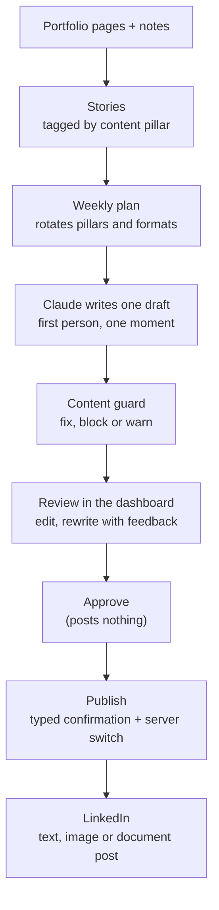

# Porto Agent: LinkedIn Drafts From Real Work

**Status:** In use | Private deployment on a personal VPS, single user, publishing gated by hand

## Executive Summary

Porto Agent turns my actual engineering work into LinkedIn drafts that sound like me, and then refuses to post any of them until I say so.

The first version did what most "AI content" tools do: it scanned git commits and turned each one into a generic tutorial plus a LinkedIn summary. Reviewing its output honestly, the problem was obvious. A commit is the wrong unit for a story, a third-person tutorial is the wrong voice for a person, and a model left to its defaults writes posts that readers recognise as machine-made within two lines.

The current version starts from **stories**: project-scale moments from real work, imported from the anonymised pages of this portfolio or typed in as short notes. It writes first-person drafts around one concrete moment per post, checks every draft against hard rules, and keeps publishing a separate, manual act.

---

## Key Results

| Metric | Value |
|--------|-------|
| Story sources | 56 stories imported from six anonymised portfolio pages, plus free-form notes |
| Formats | Text, text with a diagram image, and document carousels (PDF) |
| Writer | Headless Claude CLI on a subscription, every tool disabled |
| Guard | Runs on every draft and every edit, blocks or fixes before a person reviews |
| Publishing | Never automatic: approve and publish are separate, publish needs a typed confirmation and a server-side switch |
| Access | Behind an email-link sign-in gate, one allowlisted address |

---

## How It Works

**Stories, not commits.** A story is a section of real work told at project scale: a decision, a failure, a number that moved. Each one is tagged with one of four content pillars, and the weekly plan rotates pillars and formats while skipping anything used in the last three weeks. Drafts are created on Monday morning; nothing else happens on a schedule.

**One moment per post.** The prompt asks for a single concrete moment and the lesson behind it, in the first person singular, with at least one specific detail from the story. It forbids context-restating openers, mandatory closing questions, feature lists and invented details.

**Formats.** Text posts, posts with a diagram rendered to an image, and carousels rendered to a 4:5 PDF that LinkedIn shows as a swipeable document.

---

## Making Drafts Sound Human

The most useful part of this project was an honest evaluation of its own output. Side by side, the drafts from a fast general model shared a recognisable skeleton:

- every post opened by restating the project context;
- every post closed with "How do you...?";
- the same anonymised phrase for the client appeared in every draft;
- vocabulary such as "crucial", "fundamental" and "non-negotiable";
- lists of safeguards instead of a moment that happened.

The fixes came in three layers:

1. **A different writer.** Drafts are now written by Claude through its headless CLI on a subscription, with every built-in tool disallowed, no API key in the environment, and one call at a time.
2. **A prompt that breaks the template.** It sets the voice from real examples of writing rather than a description, asks for varied rhythm, and permits a plain ending instead of a question.
3. **A guard that reports the tells.** It counts AI-sounding words and flags question endings and "we" in solo work, so the reviewer sees them before approving.

**The writer also embellished.** It added plausible but untrue details, such as an order of events that never happened. The prompt now forbids invented events, timelines, feelings and quotes, and allows a hypothetical only when it's clearly framed as one. For a personal brand, a believable invention is worse than a dull sentence.

---

## The Content Guard

Every draft and every edit passes through the same checks before a person sees it:

| Check | Action |
|-------|--------|
| Em and en dashes, emoji | Fixed automatically |
| Academic titles or degrees | Blocks publishing |
| Any term on a private list (client, brand and colleague names) | Blocks publishing |
| Over LinkedIn's 3,000-character limit | Blocks publishing |
| Cliches, AI-sounding words, "we/our" in solo work, a question ending, too many hashtags | Warns |

The private term list lives only on the server and never in the repository, because the list itself would reveal what it protects.

---

## Publishing That Cannot Happen by Accident

The original design published as soon as a draft was approved, and a scheduled job published approved posts on weekdays. Both are gone:

1. **Approve only approves.** It records a decision and posts nothing.
2. **Publish is a separate button** on the draft page, and it requires typing a confirmation word.
3. **The server refuses** unless publishing is switched on in its environment, the draft is approved, and the guard has no blocking findings. It checks again right before anything leaves the server.
4. **No scheduler publishes.** The only scheduled jobs scan repositories and create drafts.
5. **A failure is recorded as a failure.** If the LinkedIn call fails, the draft says so instead of claiming it was posted, and a post with a diagram or a carousel either goes out exactly as reviewed or not at all.

Posting uses LinkedIn's current versioned Posts API. Post text is escaped for its markup format, where an unescaped bracket or underscore can silently cut a post short, while hashtags stay clickable.

---

## Access

The dashboard sits behind a small sign-in gate shared with my other personal apps. Visitors get a sign-in page; only an allowlisted address can request a one-time link, which Firebase Authentication emails and the gate redeems server-side before setting a signed session cookie. The page never reveals which addresses are registered, links cannot be retargeted to another address, and API clients for the other apps keep working with their own tokens.

---

## Technology Stack

| Layer | Technology |
|-------|-----------|
| Backend | Python, FastAPI, SQLAlchemy (async), PostgreSQL |
| Frontend | Next.js, TypeScript, Tailwind CSS |
| Writer | Claude via headless CLI on a subscription, tools disabled; Gemini as a fallback |
| Publishing | LinkedIn Posts API (text, images, documents), GitHub Pages for blog posts |
| Documents | ReportLab carousel PDFs, Mermaid diagrams rendered to images |
| Access | nginx auth_request, a FastAPI sign-in gate, Firebase Authentication email links |
| Operations | Docker Compose on a VPS, daily database backups, APScheduler |

---

## What I Took From It

- An AI writing tool is only as good as its worst habit, and the habits only show when you read ten drafts in a row.
- Voice comes from examples, not adjectives. "Write naturally" changes little; a real post to imitate changes a lot.
- The riskiest output of a writing model is not a bad sentence but a believable false one.
- A tool that can post in your name deserves the same safety rails as a tool that can move money.

[← Back to Projects](index.md)
